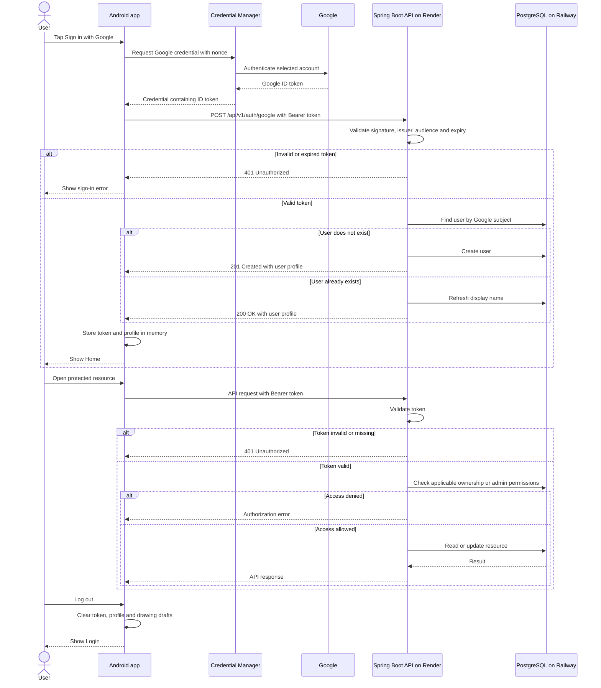

# Authentication Sequence

This document describes CardBattle's implemented Google sign-in flow:
Android Credential Manager obtains a Google ID token, and the Spring Boot
API validates that token as a bearer credential.

## Sequence

## Authentication and authorization

- Google identifies the user through the verified token's subject claim.
- First sign-in creates the application's user record.
- Returning sign-in refreshes the stored display name from Google.
- Protected requests include `Authorization: Bearer <token>`.
- Administrative permissions come from the database's `isadmin` flag.
- Resource ownership is enforced by backend services.
- Unauthorized resource lookups may return 404 to avoid exposing another
  user's private resources.
- Swagger documentation and the health endpoint are publicly accessible.

## Session behavior

The application keeps its token in memory. Logging out clears the local
application session; it does not sign the device out of its Google account.

A missing or expired token requires a new successful sign-in.